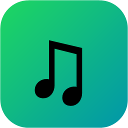
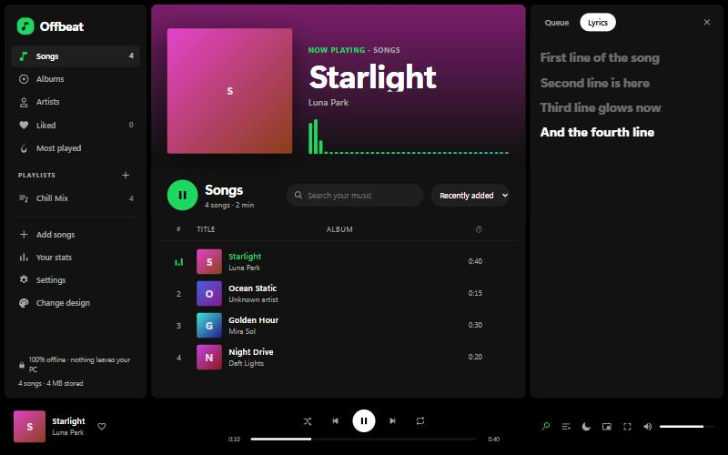
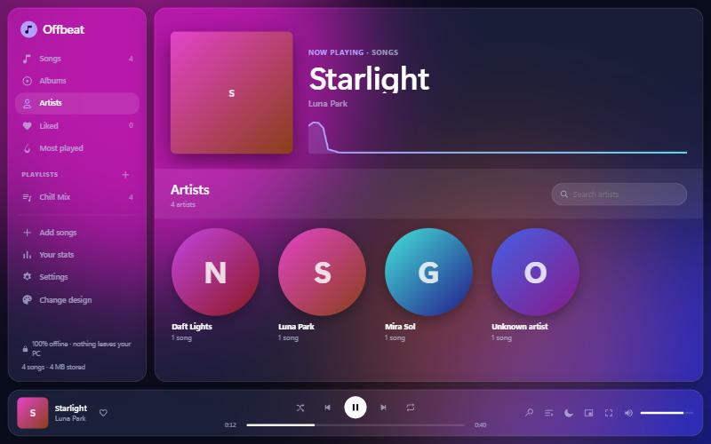
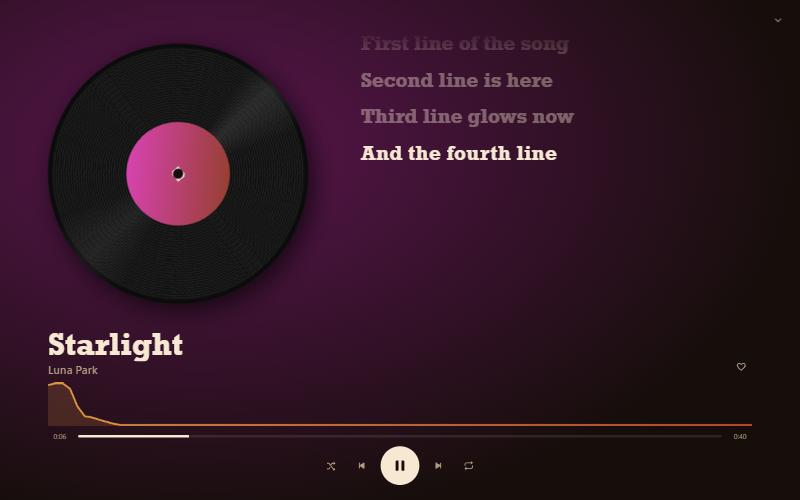
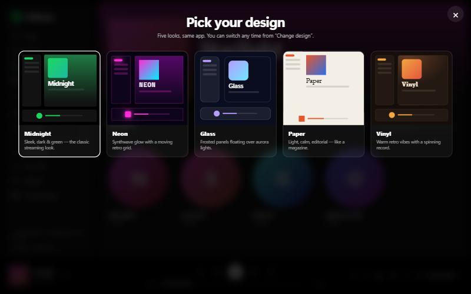

<p align="center"></p>

<h1 align="center">Offbeat</h1>
<p align="center"><b>Your own offline music player for Windows.</b><br>
Light, fast, private, and with 5 designs to pick from.</p>

<p align="center"><a href="https://github.com/Azizdos0/offbeat/releases/latest"><b>⬇ Download the latest version</b></a></p>



## Features

- **5 designs:** Midnight, Neon, Glass, Paper and Vinyl. Switch any time.
- **Colours from the album cover:** the app slowly changes colour to match the song that's playing.
- **Playlists:** create, rename and reorder them. Drag songs onto a playlist to add them.
- **Albums and Artists pages**, plus **Liked songs** and **Most played**.
- **Play queue:** "Play next" and "Add to queue", with a side panel showing what's coming up.
- **Synced lyrics:** `.lrc` files scroll and light up in time with the music.
- **Full-screen "Now Playing"** with a large cover, a visualizer and lyrics.
- **Mini player** that floats on top of your other windows.
- **5-band equalizer** with presets, **crossfade** (0–12 s) and **volume levelling**.
- **Music folder sync:** choose a folder, and new or deleted songs update on their own.
- **Sleep timer**, **listening stats**, and **picks up where you left off**.
- **Tray icon**, media keys, the Windows media overlay, and an optional **start with Windows**.
- Plays MP3, M4A/AAC, FLAC, WAV, OGG and OPUS, and reads song titles, artists and covers from MP3 tags.

| Glass design | Vinyl, full screen |
|---|---|
|  |  |



## Download & install

Go to the [**Releases page**](https://github.com/Azizdos0/offbeat/releases/latest) and pick one:

| File | Size | Use it if… |
|---|---|---|
| `Offbeat.exe` | ~48 MB | **Most people.** Works on any Windows 10/11 PC as it is. |
| `Offbeat-small.exe` | ~1.4 MB | You already have the [.NET 9 Desktop Runtime](https://dotnet.microsoft.com/download/dotnet/9.0) installed. |

Both are a single file with no installer. Put the file anywhere (for example in a folder in `Documents`) and double-click it.

> **"Windows protected your PC"?** Windows shows this for new apps that haven't paid for a code-signing certificate. Click **More info → Run anyway**. All the code is in this repo for anyone to check.

## Privacy & safety

- **No internet, ever.** The page has a Content-Security-Policy that blocks every network connection, and the app window can't open any other website.
- No accounts, no tracking, no ads.
- With a music folder chosen, Offbeat can read only the music and `.lrc` files inside that folder.
- Removing a song from Offbeat never deletes the file on your computer.
- Your library is stored in `%LOCALAPPDATA%\Offbeat`. Delete that folder to start fresh.

## Keyboard shortcuts

| Key | Action | Key | Action |
|---|---|---|---|
| `Space` | Play / pause | `L` | Like |
| `← →` | Skip 5 seconds | `S` / `R` | Shuffle / repeat |
| `Shift ← →` | Previous / next song | `Q` / `Y` | Queue / lyrics |
| `↑ ↓` | Volume | `F` / `P` | Full screen / mini player |
| `M` | Mute | `/` | Search |

## Build it yourself

You need the [.NET 9 SDK](https://dotnet.microsoft.com/download/dotnet/9.0) on Windows.

```bash
dotnet publish -c Release -o publish
```

For a single file with everything included:

```bash
dotnet publish -c Release -o publish-standalone --self-contained true -p:EnableCompressionInSingleFile=true
```

**How it's made:** the whole interface is one HTML file ([`wwwroot/index.html`](wwwroot/index.html)), packed into a small Windows app ([`Program.cs`](Program.cs)). The app uses Microsoft Edge WebView2, which comes with Windows, to show the interface. The Windows app handles the window, the tray icon, the mini player, the music folder and start with Windows. Songs you add are stored on your PC in IndexedDB.

## License

[MIT](LICENSE): free to use, change and share.
